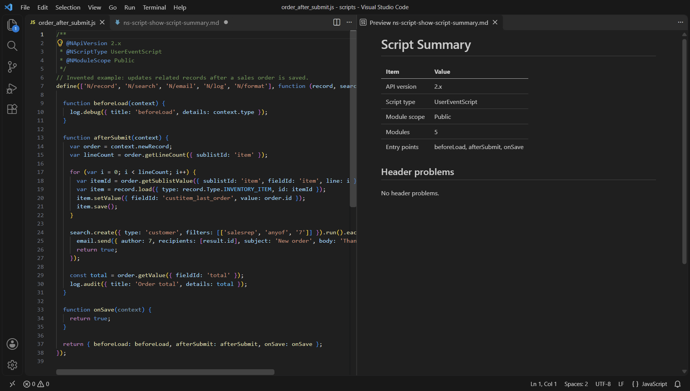
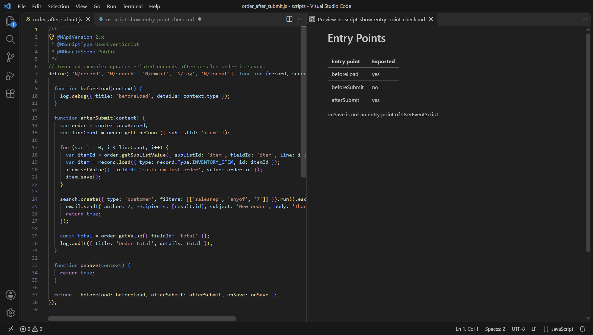
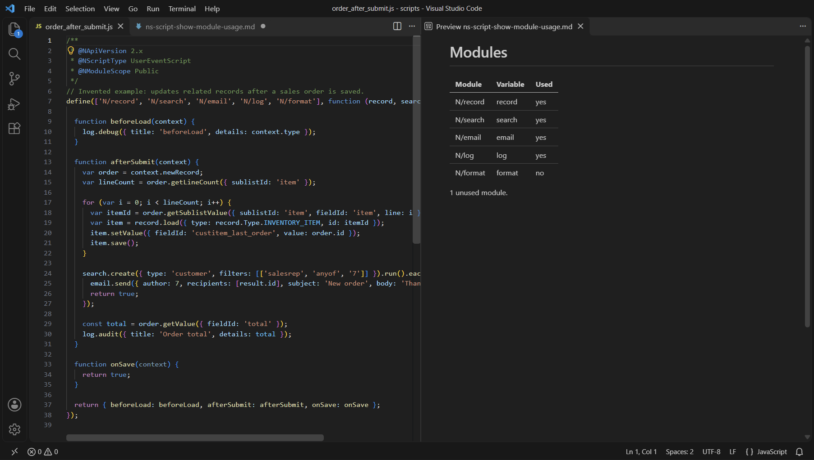
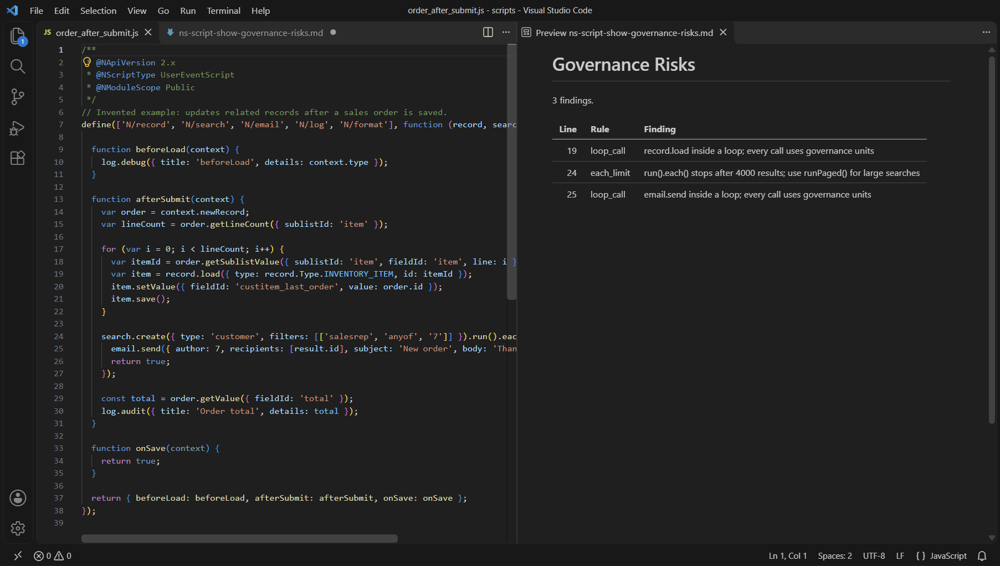
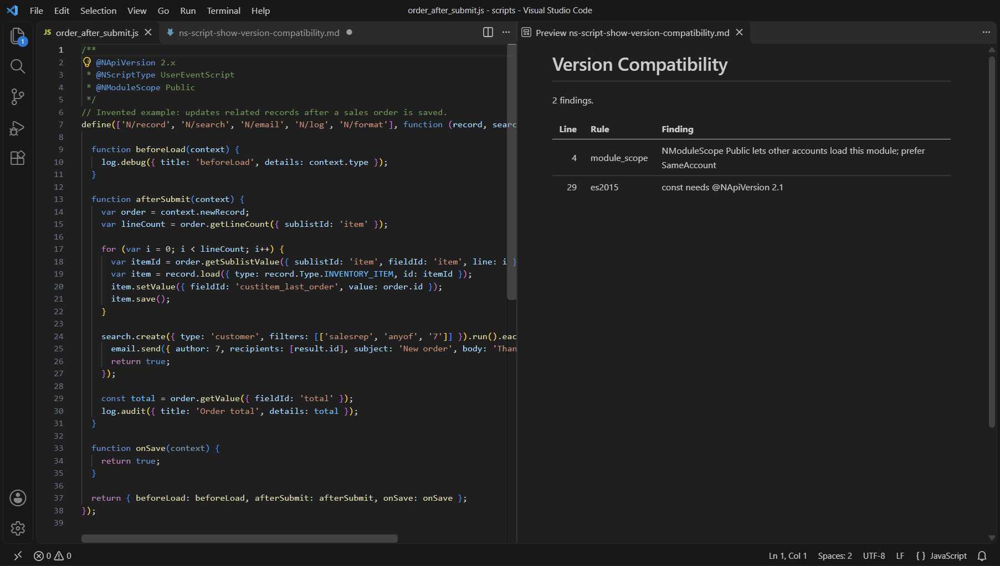

# NS Script Atlas

NS Script Atlas reads SuiteScript 2.x files and turns them into clear Markdown reports: the API version, script type and module scope from the header, the entry points the script type expects and the ones the file exports, the modules it loads and whether they are used, the calls that use governance units inside loops, SuiteScript 1.0 APIs and run().each() limits, and the ES2015 features that need API version 2.1.

Everything runs on your computer. There is no telemetry. The only network request the extension ever makes is the licence check for the optional Pro tier (see [Privacy](PRIVACY.md)).

## What it does

* **Show Script Summary**: The script at a glance: API version, script type, module scope, number of modules, exported entry points and header problems.
* **Show Entry Point Check**: The entry points the script type expects, which ones are exported, and exported names that are not entry points.
* **Show Module Usage**: Every module the script loads, the variable it is bound to, and whether it is used.
* **Show Governance Risks** (Pro): Record, search, HTTP and e-mail calls inside loops, SuiteScript 1.0 APIs and run().each() limits.
* **Show Version Compatibility** (Pro): ES2015 features that need API version 2.1, and a public module scope.

## Free, trial and Pro

| Feature | Free | Pro |
| --- | :---: | :---: |
| Show Script Summary | yes | yes |
| Show Entry Point Check | yes | yes |
| Show Module Usage | yes | yes |
| Show Governance Risks |  | yes |
| Show Version Compatibility |  | yes |
| Open Sample File, walkthrough, Report A Problem | yes | yes |

The free reports need no key, no account and no network connection, and they will not be moved behind the licence key later. The first Pro command starts a **free 14-day trial** on this computer. After that, Pro is a one-time purchase, not a subscription: **Pro Personal USD 19** (one person, use at work allowed) or **Pro Business USD 39 per user** (one key per user of an organisation). A key works on up to 3 computers. The checkout page shows the final price and any taxes for your country. Licence keys are sold by Dodo Payments, the merchant of record. Details: [licence](docs/licence.md), [terms](TERMS.md).

## Commands

Open the Command Palette and type `NS Script Atlas`.

| Command | Tier |
| --- | :---: |
| NS Script Atlas: Show Script Summary | Free |
| NS Script Atlas: Show Entry Point Check | Free |
| NS Script Atlas: Show Module Usage | Free |
| NS Script Atlas: Show Governance Risks | Pro |
| NS Script Atlas: Show Version Compatibility | Pro |
| NS Script Atlas: Open Sample File | Free |
| NS Script Atlas: Open Walkthrough | Free |
| NS Script Atlas: Show Documentation | Free |
| NS Script Atlas: Report A Problem | Free |
| NS Script Atlas: Buy Pro | Free |
| NS Script Atlas: Enter Licence Key | Free |
| NS Script Atlas: Show Licence Status | Free |
| NS Script Atlas: Remove Licence From This Machine | Free |

## Settings

| Setting | Default | Meaning |
| --- | --- | --- |
| `nsScriptAtlas.maxFileSizeMB` | 50 | Largest file a report reads (0.1 to 50 MB; VS Code passes files only up to 50 MB to extensions). |
| `nsScriptAtlas.openReportsAsPreview` | true | Open each report in the Markdown preview as well. |

## FAQ

**Does NS Script Atlas connect to my account?**
No. It reads the text of the open file only. Nothing is sent anywhere, and no account, token or deployment is needed.

**Which script types are checked?**
User event, client, scheduled, map/reduce, Suitelet, RESTlet, portlet, mass update, workflow action, bundle installation and SDF installation scripts. For each one the entry point report lists the official entry points and flags exported names that are not entry points.

**Why is const reported in a 2.x script?**
API version 2.x currently runs on the same ES5 engine as 2.0, so ES2015 features such as const, let, arrow functions, classes and template literals fail there. The compatibility report lists the first use of each feature; set @NApiVersion 2.1 to use them.

**What does the governance review look for?**
Record, search, HTTP and e-mail calls inside loops and loop callbacks (each one uses governance units), SuiteScript 1.0 APIs (nlapi and nlobj), and run().each(), which stops after 4000 results. It reads the code; it cannot measure the units a script uses at run time.

## For IT and procurement

* Publisher: SmallStepsStudio (Visual Studio Marketplace), smallstepsstudio (Open VSX).
* Network: one host, `live.dodopayments.com`, for the licence check only, and only after a key is entered. No telemetry. The trial uses no network.
* Files are read from the editor only; the extension writes no files and changes none.
* Source: <https://github.com/small-steps-studio/ns-script-atlas>.
* Licence agreement: [LICENSE.txt](LICENSE.txt). Terms: [TERMS.md](TERMS.md). Privacy: [PRIVACY.md](PRIVACY.md).

## Support

Run **NS Script Atlas: Report A Problem** or open an issue at <https://github.com/small-steps-studio/ns-script-atlas/issues>. Never post a licence key or confidential data in a public issue.

NetSuite and SuiteScript are trademarks of Oracle and/or its affiliates; NS Script Atlas is an independent product and is not affiliated with or endorsed by Oracle.
